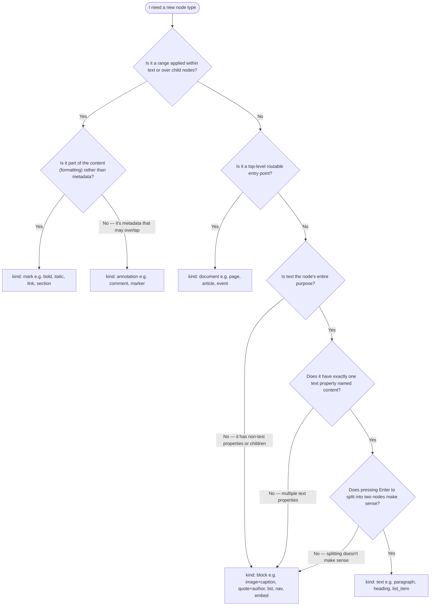

# Svedit

One editor, three frameworks. Svedit offers structured, full-canvas content editing: model content in JSON, render it with your own components, and **edit it directly in the layout**. The editor core is framework-free, and thin bindings make it feel native in Svelte 5, React 19 and Vue 3.

- Try the [Svedit demo](https://svedit.dev) (Svelte), [svedit.dev/react](https://svedit.dev/react) and [svedit.dev/vue](https://svedit.dev/vue) — watch the debug output at the bottom of the page
- Try [Editable](https://editable.website) — build Svelte websites you can edit on the page

| Package                              | npm name        | What it is                                                                             |
| ------------------------------------ | --------------- | -------------------------------------------------------------------------------------- |
| [`packages/core`](packages/core)     | `@svedit/core`  | Document model, Session, Transaction, Command, transforms, paste and export, all types |
| [`packages/svelte`](packages/svelte) | `svedit`        | Svelte 5 components and a Session with Svelte reactivity. Demo at `/`                  |
| [`packages/react`](packages/react)   | `@svedit/react` | React 19 components, hooks and a snapshot-based store. Demo at `/react/`               |
| [`packages/vue`](packages/vue)       | `@svedit/vue`   | Vue 3 components and a Session with Vue reactivity. Demo at `/vue/`                    |
| `packages/demo-shared`               | private         | The framework switcher shown at the top of every demo                                  |

Each binding re-exports everything from the core, so `import { Session, Transaction, define_document_schema } from 'svedit'` keeps working, and the React and Vue packages export the same names from `@svedit/react` and `@svedit/vue`. The document format, schema language, Session and Transaction API, transforms, commands, keymaps, clipboard payload and CSS tokens are identical across the three: a document edited in the Svelte version loads unchanged in the React or Vue version. Only the rendering layer differs, and this README calls out those differences where they matter.

## Why Svedit?

Because a modern component framework's reactivity is **the perfect fit** for building super-lightweight content editing experiences. In fact, they're so lightweight, **your content is your editor** — no context switching between a backend and the live site. Svedit just gives you the gluing pieces around **defining a custom document model** and **mapping DOM selections** to the internal model and vice versa.

## Principles

**Simplicity over completeness:** Svedit doesn't guess what your app needs or offer ready-made blocks. Instead, we keep the core lean and provide carefully crafted examples showing how to build anything on top — without compromising flexibility.

**White-box library:** We expose the internals of the library to allow you to customize and extend it to your needs. That means a little bit more work upfront, but in return lets you control "everything" — the toolbar, the overlays, or how fast the node caret blinks.

**Chromeless canvas:** Svedit keeps the editing canvas chromeless, meaning there are no UI elements like toolbars or menus mingled with the content. You can interact with text directly, but everything else happens via tools shown in separate overlays or in the fixed toolbar.

**Native-first:** Svedit favors standardized native browser solutions over custom ones whenever possible — using browser-based rendering and the browser's selection APIs underneath, rather than reimplementing them (e.g. by building on [pretext](https://github.com/chenglou/pretext)). When we hit browser bugs, we try to get them fixed upstream (in collaboration with the W3C editing working group). Workarounds we add are intended to be temporary, until the underlying issue is fixed by browser vendors. And where we believe there's a better way to solve a problem than what's currently specified, we lobby for it to become a new (or improved) web standard.

## Installation

```bash
pnpm add svedit          # Svelte 5
pnpm add @svedit/react   # React 19
pnpm add @svedit/vue     # Vue 3
```

The Svelte package ships its styles inside the components, so nothing else is needed. The React and Vue packages ship one stylesheet that you import once, next to the editor:

```js
import '@svedit/react/svedit.css'; // React
import '@svedit/vue/svedit.css'; // Vue
```

If you prefer to start from a running app, the [hello-svedit](https://github.com/michael/hello-svedit) template is a minimal SvelteKit project; for React and Vue, the demos in [`packages/react/src/routes`](packages/react/src/routes) and [`packages/vue/src/routes`](packages/vue/src/routes) are the reference. Each demo has a schema ([`demo_schema.ts`](packages/svelte/src/routes/demo_schema.ts)), a config ([`demo_config.ts`](packages/svelte/src/routes/demo_config.ts)), a toolbar and overlays you can copy and adapt.

## Quick start

A Svedit app has three framework-neutral parts — a schema, a document and a config — plus one node component per node type and a page that mounts `<Svedit>`. The schema and document below are shared by all three examples.

```js
import { define_document_schema } from 'svedit'; // or '@svedit/react', '@svedit/vue'

export const document_schema = define_document_schema({
	page: {
		kind: 'document',
		properties: {
			body: { type: 'node_array', node_types: ['paragraph'], default_node_type: 'paragraph' }
		}
	},
	paragraph: {
		kind: 'text',
		properties: {
			content: { type: 'text', mark_types: ['strong'], allow_newlines: true }
		}
	},
	strong: { kind: 'mark', properties: {} }
});

export const doc = {
	document_id: 'page_1',
	nodes: {
		page_1: {
			id: 'page_1',
			type: 'page',
			body: { nodes: ['paragraph_1'], marks: [], annotations: [] }
		},
		paragraph_1: {
			id: 'paragraph_1',
			type: 'paragraph',
			content: { content: 'Hello world.', marks: [], annotations: [] }
		}
	}
};
```

The config maps node types to components and wires up commands and keybindings. Only the component imports differ per framework:

```js
import {
	define_keymap,
	UndoCommand,
	RedoCommand,
	ToggleMarkCommand,
	BreakTextNodeCommand,
	InsertDefaultNodeCommand
} from 'svedit';

export const config = {
	node_components: { page: Page, paragraph: Paragraph, strong: Strong },
	inserters: {
		paragraph: (tr, content = { content: '', marks: [], annotations: [] }) => {
			const id = tr.generate_id();
			tr.create({ id, type: 'paragraph', content });
			tr.insert_nodes([id]);
		}
	},
	create_commands_and_keymap: (context) => {
		const commands = {
			undo: new UndoCommand(context),
			redo: new RedoCommand(context),
			toggle_strong: new ToggleMarkCommand('strong', context),
			break_text_node: new BreakTextNodeCommand(context),
			insert_default_node: new InsertDefaultNodeCommand(context)
		};
		const keymap = define_keymap({
			'meta+z,ctrl+z': [commands.undo],
			'meta+shift+z,ctrl+shift+z': [commands.redo],
			'meta+b,ctrl+b': [commands.toggle_strong],
			enter: [commands.break_text_node, commands.insert_default_node]
		});
		return { commands, keymap };
	}
};
```

### Svelte

```svelte
<!-- Paragraph.svelte -->
<script>
	import { Node, TextProperty } from 'svedit';
	let { path } = $props();
</script>

<Node {path}>
	<TextProperty tag="p" path={[...path, 'content']} placeholder="Paragraph" />
</Node>
```

```svelte
<!-- +page.svelte -->
<script>
	import { setContext } from 'svelte';
	import { Svedit, Session, KeyMapper } from 'svedit';
	import { document_schema, doc } from './schema.js';
	import { config } from './config.js';

	const session = new Session(document_schema, doc, config);
	const key_mapper = new KeyMapper();
	setContext('key_mapper', key_mapper);
	let editable = $state(true);
</script>

<svelte:window onkeydown={(event) => key_mapper.handle_keydown(event)} />
<Svedit {session} path={[session.doc.document_id]} bind:editable />
```

### React

```jsx
// Paragraph.jsx
import { Node, TextProperty } from '@svedit/react';

export default function Paragraph({ path }) {
	return (
		<Node path={path}>
			<TextProperty tag="p" path={[...path, 'content']} placeholder="Paragraph" />
		</Node>
	);
}
```

```jsx
// App.jsx
import { useEffect, useState } from 'react';
import { Svedit, Session, KeyMapper, KeyMapperContext } from '@svedit/react';
import '@svedit/react/svedit.css';
import { document_schema, doc } from './schema.js';
import { config } from './config.js';

export default function App() {
	const [session] = useState(() => new Session(document_schema, doc, config));
	const [key_mapper] = useState(() => new KeyMapper());
	const [editable, set_editable] = useState(true);

	useEffect(() => {
		const handle_keydown = (event) => key_mapper.handle_keydown(event);
		window.addEventListener('keydown', handle_keydown);
		return () => window.removeEventListener('keydown', handle_keydown);
	}, [key_mapper]);

	return (
		<KeyMapperContext.Provider value={key_mapper}>
			<Svedit
				session={session}
				path={[session.doc.document_id]}
				editable={editable}
				on_editable_change={set_editable}
			/>
		</KeyMapperContext.Provider>
	);
}
```

### Vue

```vue
<!-- Paragraph.vue -->
<script setup>
import { Node, TextProperty } from '@svedit/vue';
defineProps(['path']);
</script>

<template>
	<Node :path="path">
		<TextProperty tag="p" :path="[...path, 'content']" placeholder="Paragraph" />
	</Node>
</template>
```

```vue
<!-- App.vue -->
<script setup>
import { onBeforeUnmount, onMounted, provide, ref } from 'vue';
import { Svedit, Session, KeyMapper } from '@svedit/vue';
import '@svedit/vue/svedit.css';
import { document_schema, doc } from './schema.js';
import { config } from './config.js';

const session = new Session(document_schema, doc, config);
const key_mapper = new KeyMapper();
provide('key_mapper', key_mapper);
const editable = ref(true);

const handle_keydown = (event) => key_mapper.handle_keydown(event);
onMounted(() => window.addEventListener('keydown', handle_keydown));
onBeforeUnmount(() => window.removeEventListener('keydown', handle_keydown));
</script>

<template>
	<Svedit :session="session" :path="[session.doc.document_id]" v-model:editable="editable" />
</template>
```

The key mapper is optional: without one, `<Svedit>` still renders and edits, but the keymap returned by `create_commands_and_keymap` is not pushed when the canvas gains focus. See [Scope-aware keyboard shortcuts](#scope-aware-keyboard-shortcuts).

## How it works

Svedit connects eight key pieces:

1. **Schema** - Define your content structure (node types, properties, marks, annotations)
2. **Document** - An actual document, containing a `document_id` and a flat map of nodes that hold the content
3. **Session** - Manages the document, selection state, and history
4. **Transaction** - Groups multiple document operations (create, delete, set) into a single atomic unit with undo/redo support
5. **Transforms** - Higher-level composable functions that run inside a transaction (e.g., `break_text_node`, `join_text_node`) to modify the document.
6. **Config** - Maps node types to components, provides inserters and commands
7. **Components** - Render your content with your framework (one component per node type)
8. **Commands** - User actions (bold text, insert node, undo/redo) that modify the session

**The flow:**

- Define a schema → create a session → provide config → render with the `<Svedit>` component
- User interactions trigger commands → commands create transactions → which run transforms to modify the document → session applies the transaction → the framework's reactivity (or, in React, the session subscription) updates the UI
- Native DOM selections are mapped to Svedit's internal selection model

## Schema

You can use a simple JSON-compatible schema definition language to enforce constraints on your documents. E.g. to make sure a page node always has a property body with references to nodes that are allowed within a page.

First off, everything is a node. The page is a node, and so is a paragraph, a list, a list item, a nav and a nav item.

Each node has a `kind` that determines its behavior:

- `document`: A top-level node accessible via a route (e.g. a page, event)
- `block`: A structured node that contains other nodes or properties
- `text`: A node with editable text content (can be split and joined)
- `mark`: A content-level range applied to text or a node array (bold, link, section, etc.). Marks are mutually exclusive and render in-place.
- `annotation`: A metadata/overlay range applied to text or a node array (comments, markers, etc.). Annotations may overlap and are data-only.

### Choosing between `text` and `block`

`kind: 'text'` opts into the split/join system (`break_text_node`, `join_text_node`), which assumes:

- The node has exactly **one** `text` property named **`content`**
- Pressing Enter splits the node into two nodes of the same type
- Pressing Backspace at position 0 joins it with the previous node

When `break_text_node` splits through a mark or annotation, the right-hand occurrence receives an independent attachment node with the same properties. Editing one link or annotation therefore does not change the other. Ranges moved wholly to one side retain their ids. Subtree copying and pasting through `Transaction.build` also detach repeated attachment references in the copied data. These operations do not rewrite attachment references in existing stored documents.

If **any** of those assumptions don't hold, use `kind: 'block'`. Blocks can still have `text` properties with full editing support (typing, formatting, selection) — they just don't participate in split/join.

> **Common mistake:** A quote node with `content` + `author` properties might seem like `kind: 'text'` because both fields are editable text. But splitting a quote into two half-quotes doesn't make sense, and `join_text_node` hard-codes `node.content` — so Backspace in the `author` field would join the wrong property with the previous block and drop the author text. The correct kind is `'block'`.

<details>
<summary>Decision tree for choosing a node kind</summary>



</details>

Properties of nodes can hold values:

- `string`: A good old JavaScript string. Use optional `values` to restrict it to an ordered set of allowed strings.
- `number`: Just like a number in JavaScript
- `integer`: A number for which Number.isInteger(number) returns true. Optional `min` and `max` bounds are inclusive.
- `boolean`: true or false
- `datetime`: A date/time string parseable by `Date.parse()`
- `string_array`: An array of strings
- `number_array`: An array of numbers
- `integer_array`: An array of integers
- `boolean_array`: An array of booleans
- `text`: Plain text content with marks (bold, italic, link etc.) and annotations (comments etc.). Text values use `{ content: '', marks: [], annotations: [] }`. Set `allow_newlines: true` to let users insert line breaks with Shift+Enter, or `false` to keep content single-line (e.g. for titles).

Or references:

- `node`: References a single node (e.g. an image node can reference a global asset node)
- `node_array`: References a sequence of nodes (e.g. page.body references paragraph and list nodes)

`node_array` properties use `node_types` for the child node types they can contain, plus optional `mark_types` for marks that can wrap ranges of child nodes and optional `annotation_types` for overlay annotations.

```js
const document_schema = {
	page: {
		kind: 'document',
		properties: {
			body: {
				type: 'node_array',
				node_types: ['nav', 'paragraph', 'list'],
				mark_types: ['section'],
				annotation_types: ['comment'],
				default_node_type: 'paragraph'
			}
		}
	},
	paragraph: {
		kind: 'text',
		properties: {
			content: {
				type: 'text',
				mark_types: ['strong', 'emphasis', 'link'],
				annotation_types: ['comment'],
				allow_newlines: true
			}
		}
	},
	list_item: {
		kind: 'text',
		properties: {
			content: {
				type: 'text',
				mark_types: ['strong', 'emphasis', 'link'],
				allow_newlines: true
			}
		}
	},
	list: {
		kind: 'block',
		properties: {
			list_items: {
				type: 'node_array',
				node_types: ['list_item'],
				default_node_type: 'list_item'
			}
		}
	},
	nav: {
		kind: 'block',
		properties: {
			nav_items: {
				type: 'node_array',
				node_types: ['nav_item'],
				default_node_type: 'nav_item'
			}
		}
	},
	nav_item: {
		kind: 'block',
		properties: {
			url: { type: 'string' },
			label: { type: 'string' }
		}
	},
	strong: {
		kind: 'mark',
		properties: {}
	},
	emphasis: {
		kind: 'mark',
		properties: {}
	},
	link: {
		kind: 'mark',
		properties: {
			href: { type: 'string' }
		}
	},
	section: {
		kind: 'mark',
		properties: {}
	},
	comment: {
		kind: 'annotation',
		properties: {}
	}
};
```

Mark types are defined as nodes with `kind: 'mark'`, annotation types as nodes with `kind: 'annotation'`. Simple marks like `strong` and `emphasis` have no properties, while marks like `link` can carry data (e.g. `href`). Each `text` or `node_array` property specifies which types are allowed via `mark_types` and `annotation_types` — this lets you control formatting per property (e.g. allow bold and links in body text, but only emphasis in titles). `mark_types` may only reference `kind: 'mark'` node types and `annotation_types` only `kind: 'annotation'` node types.

Wrap the schema in `define_document_schema(...)` to get a schema-typed `Session<typeof document_schema>`, so `session.get(path)` results can be annotated with your own node types (see the `Nodes` helper type in the demos' `demo_schema.ts`).

## Document

A document is a plain JavaScript object (POJO) with a `document_id` (the entry point) and a `nodes` object containing all content nodes. The format is the same in all three bindings, so documents can be shared between a Svelte, a React and a Vue application.

Rules:

- All nodes must be reachable from the document node (unreachable nodes are discarded)
- No cyclic references allowed
- Text properties use `{ content: '', marks: [], annotations: [] }`
- Node array properties use `{ nodes: [], marks: [], annotations: [] }`

### Node IDs

Node IDs uniquely identify nodes inside a document. They are also used whenever one node references another node, for example in `node`, `node_array.nodes`, and mark or annotation `node_id` values.

Because Svedit also uses these IDs in HTML ids, document paths, and CSS selectors, IDs need to follow a simple, safe format:

- It must be a string.
- It must not be empty.
- It must start with a letter (`A-Z`, `a-z`) or underscore (`_`).
- After the first character, it may contain letters, numbers, underscores, or dashes.
- It must not contain Svedit's path separator `__`.

Valid examples:

```js
'page_1';
'story-hero';
'_temporary_node';
```

Invalid examples:

| ID          | Why invalid                                         |
| ----------- | --------------------------------------------------- |
| `1`         | Not a string                                        |
| `'1'`       | Serialized paths would treat this as an array index |
| `'1_page'`  | Starts with a number                                |
| `'page.1'`  | `.` is not allowed                                  |
| `'page__1'` | `__` is reserved as Svedit's path separator         |

The `doc.nodes` map key must also match the node's own `id`:

```js
nodes: {
	page_1: {
		id: 'page_1',
		type: 'page'
		// ...
	}
}
```

If you provide `config.generate_id`, every generated ID must follow the same rules. Svedit validates generated IDs immediately and throws if the provider returns an invalid value:

```js
const session_config = {
	generate_id: () => `node_${crypto.randomUUID()}`
};
```

Provide your own generator: use short custom-alphabet `nanoid` IDs for local documents, monotonic ULIDs (`ulid`) for sortable/synced IDs, or prefixed UUIDs for globally unique IDs.

Here's an example document:

```js
const doc = {
	document_id: 'page_1',
	nodes: {
		strong_1: {
			id: 'strong_1',
			type: 'strong'
		},
		section_1: {
			id: 'section_1',
			type: 'section'
		},
		nav_item_1: {
			id: 'nav_item_1',
			type: 'nav_item',
			url: '/homepage',
			label: 'Home'
		},
		nav_1: {
			id: 'nav_1',
			type: 'nav',
			nav_items: { nodes: ['nav_item_1'], marks: [], annotations: [] }
		},
		paragraph_1: {
			id: 'paragraph_1',
			type: 'paragraph',
			content: {
				content: 'Hello world.',
				marks: [{ start_offset: 0, end_offset: 5, node_id: 'strong_1' }],
				annotations: []
			}
		},
		list_item_1: {
			id: 'list_item_1',
			type: 'list_item',
			content: { content: 'First list item', marks: [], annotations: [] }
		},
		list_item_2: {
			id: 'list_item_2',
			type: 'list_item',
			content: { content: 'Second list item', marks: [], annotations: [] }
		},
		list_1: {
			id: 'list_1',
			type: 'list',
			list_items: { nodes: ['list_item_1', 'list_item_2'], marks: [], annotations: [] }
		},
		page_1: {
			id: 'page_1',
			type: 'page',
			body: {
				nodes: ['nav_1', 'paragraph_1', 'list_1'],
				marks: [{ start_offset: 1, end_offset: 3, node_id: 'section_1' }],
				annotations: []
			}
		}
	}
};
```

### Marks and annotations

Marks and annotations are regular nodes attached to a range in a property value. Both use the same attachment shape:

```js
{
	start_offset: 0,
	end_offset: 5,
	node_id: 'strong_1'
}
```

They differ in semantics:

- **Marks** are part of the content (bold, italic, link, section). They are mutually exclusive within a property and are rendered in-place by `<TextProperty>`/`<NodeArrayProperty>`.
- **Annotations** are metadata layered over the content (comments, markers). They may overlap marks and each other, and are data-only: Svedit keeps and transforms the data (and adds CSS classes to covered node wrappers), but your app is responsible for interpreting it. Annotation types must not have registered components.

For `text` properties, offsets address character positions in the `content` string:

```js
{
	id: 'paragraph_1',
	type: 'paragraph',
	content: {
		content: 'Hello world.',
		marks: [{ start_offset: 0, end_offset: 5, node_id: 'strong_1' }],
		annotations: [{ start_offset: 3, end_offset: 8, node_id: 'comment_1' }]
	}
}
```

For `node_array` properties, offsets address node positions in the `nodes` array. This lets you wrap a contiguous group of child nodes with the same range model:

```js
{
	id: 'page_1',
	type: 'page',
	body: {
		nodes: ['paragraph_1', 'paragraph_2', 'paragraph_3'],
		marks: [{ start_offset: 1, end_offset: 3, node_id: 'section_1' }],
		annotations: []
	}
}
```

The ranges are half-open: `start_offset` is included, `end_offset` is excluded. Marks must not overlap; annotations may overlap (including same-type annotations created through lower-level APIs).

### Document schema changes

Svedit validates documents against the current schema when you create a `Session`. If you change the schema, you are responsible for migrating existing documents before loading them.

For simple additive changes, defaults can help. When you add a new property, you can call `fill_document_defaults` before creating the session:

```js
import { Session, fill_document_defaults } from 'svedit';

const document_schema = {
	paragraph: {
		kind: 'text',
		properties: {
			layout: {
				type: 'string',
				values: ['image-left', 'image-right', 'stacked'],
				default: 'image-left'
			},
			content: {
				type: 'text',
				allow_newlines: true
			}
		}
	}
};

const migrated_doc = fill_document_defaults(existing_doc, document_schema);
const session = new Session(document_schema, migrated_doc, config);
```

This only fills properties that are missing. Explicit schema `default` values are used when present; otherwise Svedit uses built-in defaults for value types such as strings, numbers, booleans, arrays, `node_array`, and `text`. Constraints such as `values`, `min`, and `max` do not change those defaults, so declare an explicit `default` when the built-in value would be invalid. Existing values are preserved, and the original document object is not mutated.

Defaults make it safe to add new defaultable properties, but they are not a replacement for real document migrations. If you rename a property, remove a property, split one property into several, change node types, or need to transform existing data, write your own migration first and use `fill_document_defaults` only as a helper where appropriate.

`tr.create` and `tr.build` also fill omitted defaults for newly-created nodes. For document migrations, declare explicit defaults whenever the built-in type default is not the value you want. Do not rely on default filling for schema changes that need a real migration.

## Config

Documents need a config object that tells Svedit how to render and manipulate your content. See the full example in `demo_config.ts` of each demo ([Svelte](packages/svelte/src/routes/demo_config.ts), [React](packages/react/src/routes/demo_config.ts), [Vue](packages/vue/src/routes/demo_config.ts)).

```js
const session_config = {
	// ID generator for creating new nodes
	generate_id: () => nanoid(),

	// User-land overlays and optional system component overrides
	system_components: { overlays: Overlays, node_gap_tools: GapInsertTool },

	// Map node types to components of your framework
	node_components: { page: Page, paragraph: Paragraph, story: Story, list: List, strong: Strong, ... },

	// Functions that create and insert new nodes
	inserters: {
		paragraph: (tr, content = { content: '', marks: [], annotations: [] }) => {
			const paragraph_id = tr.generate_id();
			tr.create({ id: paragraph_id, type: 'paragraph', content });
			tr.insert_nodes([paragraph_id]);
		}
	},

	// Returns { commands, keymap } for the editor instance
	create_commands_and_keymap: (context) => { ... },

	// Optional: handle media paste events
	handle_media_paste: async (session, pasted_media) => { ... }
};
```

**Key config options:**

- **`generate_id`** - Function that generates unique IDs for new nodes (defaults to `node_${crypto.randomUUID()}`)
- **`node_components`** - Maps each node type from your schema to a component (a Svelte component, a React component or a Vue component, depending on the binding)
- **`system_components`** - Optional overrides for internal editor components and a slot for your own overlays:
  - `overlays` — A component rendered inside `<Svedit>` but outside the content canvas. Use it to add floating UI like link editors, image toolbars, or annotation popovers that appear near the current selection. See `Overlays` in the demos ([Svelte](packages/svelte/src/routes/components/Overlays.svelte), [React](packages/react/src/routes/components/Overlays.tsx), [Vue](packages/vue/src/routes/components/Overlays.vue)).
  - `node_gap`, `node_gap_markers`, `node_selection_markers` — Override the default system components if you need custom visuals for node gaps or selection indicators.
  - `node_gap_tools` — A component rendered inside the active node gap marker, next to the caret. Use it for gap-scoped tools like an insert button: it inherits the `--row` orientation variable from the node array, and it appears and disappears together with the caret. Receives `{ path, offset, is_first, is_last }` (see the `NodeGapToolsProps` type). The marker has `pointer-events: none`, so interactive tools must set `pointer-events: auto`. See `GapInsertTool` in the demos.
- **`inserters`** - Functions that create blank nodes of each type and set up the selection. `insert_default_node` and the split/join transforms call the inserter of the target node type with `(tr, content?)`.
- **`create_commands_and_keymap`** - Factory function that creates commands and keybindings for an editor instance
- **`handle_media_paste(session, pasted_media)`** - Optional handler for pasted files. You can upload/process files, replace an existing media property, or return a node payload to insert new content. (`handle_image_paste` is still accepted as a legacy alias.)
- **`handle_property_deletion(tr, path)`** - Optional handler called when deleting/cutting a property selection. Use it to define app-specific reset behavior on the transaction (for example clearing an image property or resetting a referenced media node).
- **`html_paste`**, **`mark_html_exporters`**, **`html_exporters`** - Rich-text import and export, see below.
- **`view_classes`** - Viewport visibility classes. Every node element gets `.in-view`, `.seen`, `.fully-in-view`, `.visible-top`, `.visible-bottom` toggled as it scrolls through the viewport. Useful for scrollytelling and reveal animations driven from CSS. **On by default**. Set `view_classes: false` to opt out — saves ~5 classList ops per IO entry (measurable scroll-FPS win at 200+ nodes) and reduces the IntersectionObserver work during scroll. Disable if your app doesn't read these classes from CSS.
- **`visibility_culling`** - Gates the anchor positioning of node gaps and markers by viewport proximity (an overscan IntersectionObserver). **On by default**. `visibility_culling: false` is intended for debugging only: it makes anchor positioning O(N) over every node in the document, and large documents can become unresponsive without it.

The config is accessible throughout your app via `session.config`.

### Importing pasted HTML

Set `config.html_paste` to enable external HTML import. Without it, paste keeps its
existing plain-text behavior. Native Svedit clipboard data and media paste keep
their existing paths and bypass this importer.

```ts
import type { HtmlPasteConfig } from 'svedit';

const html_paste: HtmlPasteConfig = {
	blocks: {
		p: { type: 'paragraph', text_property: 'content' },
		h1: { type: 'heading1', text_property: 'content' },
		h2: { type: 'heading2', text_property: 'content' }
	},
	marks: {
		bold: { type: 'strong' },
		link: ({ href }) => ({ type: 'link', properties: { href } })
	}
};

const config = { /* other configuration */ html_paste };
```

Use your app's schema names (the demo uses `heading_1`, for example). Blocks accept
`p` and `h1` through `h6`. Each mapping names a text node type and its text property.
A block mapping can also be a synchronous factory returning the same descriptor,
with extra node properties, or `null` to use the destination's default text node:

```ts
h1: ({ tag }) => ({
	type: 'heading',
	text_property: 'content',
	properties: { level: Number(tag.slice(1)) }
});
```

`<strong>` and `<b>` use the `bold` mapping. Link factories receive the decoded,
trimmed `href`; they may return `null` to discard link formatting. The importer
accepts HTTP(S), mailto, tel, and relative links, and drops unsafe schemes.
Mappings describe data; they should not mutate the session. Svedit creates IDs
and fills schema defaults through its normal insertion transaction.

Map HTML lists separately because they contain an array of text nodes:

```ts
html_paste.lists = {
	ul: {
		type: 'list',
		children_property: 'list_items',
		item: { type: 'list_item', text_property: 'content' },
		properties: { layout: 'square' }
	},
	ol: {
		type: 'list',
		children_property: 'list_items',
		item: { type: 'list_item', text_property: 'content' },
		properties: { layout: 'decimal' }
	}
};
```

All type and property names come from your schema. Nested HTML lists flatten into
one list in item order, using the outer list's mapping. An item with multiple
paragraphs becomes one text node. Unmapped or disallowed lists fall back to the
destination's default text nodes; text fields receive flattened list text.

If a destination requires a containing block, configure an optional wrapper:

```ts
html_paste.wrapper = { type: 'prose', children_property: 'body' };
```

The wrapper is used only when blocks cannot be mapped directly to the destination
and the destination allows its type. Its `children_property` must be a node array;
blocks are mapped against that property's allowed node types. Wrapper mappings
also accept `properties` for schema-specific defaults.

Import respects the destination's allowed node and mark types. Unmapped or
disallowed headings fall back to its default text node; unsupported marks keep
their text. Marks are exclusive in Svedit, so a supported link takes precedence
over bold where they overlap. Existing active-mark insertion behavior still applies.

At a node caret, HTML blocks become nodes. A single text block pasted into text
retains the destination node type. A configured list follows the node insertion
path, even when it contains only one item. Multiple blocks pasted into a text node
follow the existing multi-paragraph behavior: insert nodes after that node without splitting
or replacing its text. In block fields such as titles and captions, blocks are
joined with blank lines, or spaces when `allow_newlines` is false.

The importer recognizes semantic tags, common block wrappers, entities and
`<br>`. Unsupported containers retain their text but do not import table
structure, images, or CSS formatting. Lists retain structure when a list mapping
is configured. Script/style content is ignored. Empty or
unusable HTML, and mapping errors, fall back to the existing plain-text path.

### Exporting copied rich text

Copy and cut include both the embedded `data-svedit` payload and readable HTML.
Configure `mark_html_exporters` to map your schema's marks to HTML. Unknown marks
keep their text; data-only annotations remain in the native payload.

```ts
import { export_text_html, escape_html, safe_html_href } from 'svedit';
import type { MarkHtmlExporter } from 'svedit';

const mark_html_exporters = {
	strong: (_node, content) => `<strong>${content}</strong>`,
	link: (node, content) => {
		const href = safe_html_href(node.href || '');
		return href ? `<a href="${escape_html(href)}">${content}</a>` : content;
	}
} satisfies Record<string, MarkHtmlExporter>;

const config = {
	mark_html_exporters,
	html_exporters: {
		paragraph: (node, session) => `<p>${export_text_html(node.content, session)}</p>`,
		heading1: (node, session) => `<h1>${export_text_html(node.content, session)}</h1>`
	}
};
```

Text selections and the default node exporter use this automatically. Existing
custom `html_exporters` should call `export_text_html` for their text properties,
as above. The helper escapes text, preserves line breaks with `<br>`, and uses
Svedit's grapheme offsets. Mark exporters receive already escaped inline HTML;
only attribute values need escaping. Import and export mappings are separate
because import factories cannot be reliably reversed.

## Session

The `Session` class manages your content graph, selection state, and history. The framework-free implementation lives in [`packages/core/src/lib/Session.ts`](packages/core/src/lib/Session.ts); each binding exports a `Session` subclass that plugs in its reactivity (see [Framework differences at a glance](#framework-differences-at-a-glance)).

### Immutable state

Document content (`session.doc`) and selection (`session.selection`) are **immutable** with **copy-on-write** semantics. When a change is made, only the modified parts are copied — unchanged nodes keep their original references. State is held in plain fields and reassigned rather than mutated, so there are no deep reactive proxies and `console.log(session.get(some_node_id))` gives you a readable plain object. Every reassignment notifies the session's subscribers, which is how the bindings know what to re-render.

Two rules follow from this for application code. Treat everything you read from the session as read-only: to change a value, make a transaction. And apply a transaction to the document it was created from: `session.tr` snapshots the current document, so create the transaction right before you use it. Applying a transaction after another change (an apply, undo, redo or a doc assignment) throws instead of silently overwriting that change. Values you pass to `tr.set` and `tr.create` are copied, so you may reuse or mutate your own objects afterwards.

The properties the bindings rely on are listed in [`packages/core/CLAUDE.md`](packages/core/CLAUDE.md) and pinned by [`packages/core/src/test/invariants.test.ts`](packages/core/src/test/invariants.test.ts).

### Creating a session

```js
import { Session } from 'svedit';

const session = new Session(schema, doc, config);
```

Import `Session` from the binding you use (`svedit`, `@svedit/react` or `@svedit/vue`), not from `@svedit/core`: the binding's subclass is what installs the framework's reactivity.

### Reading the graph

```js
session.get(['page_1', 'body']); // => { nodes: ['nav_1', 'paragraph_1', 'list_1'], marks: [], annotations: [] }
session.get(['nav_1']); // => { id: 'nav_1', type: 'nav', ... }
session.get('nav_1'); // => shorthand for above (single node ID)
session.inspect(['page_1', 'body']); // => { kind: 'property', type: 'node_array', node_types: [...] }
session.kind(node); // => 'text', 'block', 'mark', or 'annotation'
```

### Selection and state

```js
session.selection; // Current selection (text, node, or property)
session.selected_node; // The currently selected node (derived)
session.selected_marks; // Mark records touched by the current selection (derived)
session.active_mark; // The selected mark record when exactly one mark is touched, otherwise null
session.selected_annotations; // Annotation records touched by the current selection (derived)
session.active_annotation; // The selected annotation record when exactly one annotation is touched, otherwise null
session.can_insert('paragraph'); // Check if node type can be inserted
session.available_mark_types; // Mark types allowed at current selection (derived)
session.available_annotation_types; // Annotation types allowed at current selection (derived)
```

Derived values are memoized per session change and remember which fields they read, so they are cheap to read from templates and commands.

#### Native selection as source of truth

Every selection that can exist in Svedit must have a DOM representation. This is a core design decision: the browser's native selection determines where the selection is, and `session.selection` is derived from it — not the other way around. If the DOM selection stops being the source of truth, selection mapping becomes ambiguous and Svedit loses the simplicity and determinism that the editor is built on.

This applies to all selection types:

- Text selections are native selections inside a `text` property.
- Node selections are native selections whose anchor and focus land inside the selected node range.
- Property selections are native selections inside the DOM representation of that property.

For example, a multi-node selection is still represented as a native browser selection that starts somewhere inside one node and ends somewhere inside another. Svedit maps that DOM selection to an internal node selection, hides the browser's visual selection, and renders `NodeSelectionMarkers` instead. The native selection remains in the DOM behind the scenes because `contenteditable` still needs it to do its job: pressing an arrow key should move the cursor from the current focus point to the closest valid next position, and Shift+Arrow should expand the selection from that same focus point. Without a native selection rendered at all times, the browser has no reliable starting point for cursor movement, selection expansion, or other editing behavior.

### Making changes

```js
const tr = session.tr; // Create a transaction
tr.set(['nav_1', 'label'], 'Home');
tr.insert_nodes(['new_node_id']);
session.apply(tr); // Apply the transaction
```

#### Batching history entries

By default, every `session.apply(tr)` creates a new undo/redo entry. Pass `{ batch: true }` to merge the transaction into the previous history entry instead — useful for continuous interactions like typing or dragging, where you want the entire gesture to undo as one step.

```js
session.apply(tr, { batch: true });
```

Batched transactions merge into the current history entry as long as they arrive within a 1-second window of the batch start. After 1 second of inactivity, the next `apply` starts a fresh entry. To force a new entry immediately (e.g. on pointer up), reset the batch timer:

```js
session.last_batch_started = undefined;
```

### History

```js
session.can_undo; // Boolean (derived)
session.can_redo; // Boolean (derived)
session.undo();
session.redo();
```

### Detecting unsaved changes

Because document state is immutable, you can detect unsaved changes by comparing references. When a change is made, `session.doc` gets a new reference — unchanged documents keep the same reference. This works because of Svedit's copy-on-write strategy: only modified parts of the document are copied, so reference equality is a reliable and efficient way to detect changes. You can use `has_unsaved_changes` to show/hide a save button, display a dirty indicator, or warn before navigating away.

<details open>
<summary>Svelte</summary>

```js
let last_saved_doc = $state(null);
let has_unsaved_changes = $derived.by(() => {
	if (!last_saved_doc) {
		// No save yet — use undo history as indicator
		return session.can_undo;
	} else {
		// Compare current doc reference against last saved
		return last_saved_doc !== session.doc;
	}
});

function save() {
	// ... save to server ...
	last_saved_doc = session.doc;
}
```

</details>

<details>
<summary>React</summary>

```jsx
import { useState } from 'react';
import { useVersion } from '@svedit/react';

function SaveButton({ session }) {
	const [last_saved_doc, set_last_saved_doc] = useState(null);
	// Re-render on every session change
	useVersion(session);
	const has_unsaved_changes = last_saved_doc
		? // Compare current doc reference against last saved
			last_saved_doc !== session.doc
		: // No save yet — use undo history as indicator
			session.can_undo;

	function save() {
		// ... save to server ...
		set_last_saved_doc(session.doc);
	}

	return (
		<button disabled={!has_unsaved_changes} onClick={save}>
			Save
		</button>
	);
}
```

</details>

<details>
<summary>Vue</summary>

```js
import { computed, shallowRef } from 'vue';

const last_saved_doc = shallowRef(null);
const has_unsaved_changes = computed(() => {
	if (!last_saved_doc.value) {
		// No save yet — use undo history as indicator
		return session.can_undo;
	} else {
		// Compare current doc reference against last saved
		return last_saved_doc.value !== session.doc;
	}
});

function save() {
	// ... save to server ...
	last_saved_doc.value = session.doc;
}
```

</details>

### Reading session state from components

The session notifies subscribers whenever a field is reassigned. How a component subscribes depends on the binding:

- **Svelte:** the `svedit` Session keeps one `$state` signal per field. Reading `session.doc`, `session.selection`, `session.can_undo` or a command's `disabled` inside a `$derived`, `$effect` or template subscribes automatically. Get the editor context with `getContext('svedit')`.
- **Vue:** the `@svedit/vue` Session keeps one `shallowRef` per field and marks the session raw. Reads inside `computed`, `watchEffect` or templates subscribe automatically. Get the editor context with `inject('svedit')`.
- **React:** nothing is tracked implicitly. Components pick what they need with a selector, and re-render only when that value changes:

```jsx
import { useSvedit, useNode, useVersion, useSveditContext } from '@svedit/react';

// Re-render when the selected value changes (compared with Object.is)
const editable = useSvedit((ctx) => ctx.editable);
const can_undo = useSvedit((ctx) => ctx.session.can_undo);

// Shortcut for the node (or property value) at a path. Values are
// copy-on-write, so an unchanged node keeps its reference.
const node = useNode(path);

// The raw context object (session, editable, canvas_el, focus_canvas, ...)
const svedit = useSveditContext();

// Re-render on every change (e.g. for a toolbar that reads many values)
useVersion(session);
```

`useSvedit`, `useNode` and `useSveditContext` must be called inside a component rendered under `<Svedit>`. Pass `shallow_equal` (exported from `@svedit/react`) as the second argument of `useSvedit` when the selector returns a fresh object. Outside the editor tree, subscribe with `useSnapshot([session], () => ...)` or `useVersion(session)`.

The editor context has the same shape in all three bindings (`SveditContext`): `session`, `editable`, `is_composing`, `canvas_el`, `canvas_focused` and `focus_canvas()`. The React context additionally exposes `subscribe` and `version` for its own state.

### Utilities

```js
session.doc.document_id; // The document's root ID
session.generate_id(); // Generate a new unique ID
session.config; // Access the config object
session.to_json(); // Serialize the reachable document for persistence
session.traverse(node_id); // Get all nodes reachable from a node
session.select_parent(); // Select parent of current selection
```

## Transforms

Transforms are pure functions that modify a transaction. They encapsulate common editing operations like breaking text nodes, joining nodes, or inserting new content.

Transforms take a transaction (`tr`) as their parameter and return `true` if successful or `false` if the transform cannot be applied (e.g., wrong selection type or invalid state).

```js
// Example: break a text node at the caret
import { break_text_node } from 'svedit';

const tr = session.tr;
const success = break_text_node(tr);
if (success) {
	session.apply(tr);
}
```

### Built-in transforms

Svedit provides several core transforms in [`packages/core/src/lib/transforms.ts`](packages/core/src/lib/transforms.ts):

- `break_text_node(tr)` - Split a text node at the caret position
- `join_text_node(tr)` - Join current text node with the previous one
- `insert_default_node(tr)` - Insert a new node at the current selection
- `set_properties(tr, path, properties)` - Set several properties of a node at once (a helper that returns nothing)

### Composability

Transforms are composable. You can build higher-level transforms from lower-level ones:

```js
function custom_transform(tr) {
	// Compose multiple transforms
	if (!break_text_node(tr)) return false;
	if (!insert_default_node(tr)) return false;
	return true;
}
```

### Writing your own transforms

You're encouraged to write custom transforms for your application's specific needs. Keep them pure functions that operate on the transaction object:

```js
function insert_heading(tr) {
	const selection = tr.selection;

	if (selection?.type !== 'node') return false;

	// Create and insert a heading node
	const heading_id = tr.generate_id();
	tr.create({
		id: heading_id,
		type: 'heading',
		content: { content: '', marks: [], annotations: [] }
	});
	tr.insert_nodes([heading_id]);

	return true;
}
```

## Transaction

Transactions group multiple operations into atomic units that can be applied and undone as one. They provide the same read API as sessions (`tr.get()`, `tr.inspect()`, `tr.kind()`, `tr.generate_id()`), so transforms can query document state directly. See [`packages/core/src/lib/Transaction.ts`](packages/core/src/lib/Transaction.ts) for the full API.

### Basic usage

```js
const tr = session.tr; // Create a new transaction
tr.set(['node_1', 'title'], 'New Title'); // Modify properties
session.apply(tr); // Apply atomically
```

### Node operations

```js
// Create a new node (must include all required properties from schema)
tr.create({
	id: 'paragraph_1',
	type: 'paragraph',
	content: { content: '', marks: [], annotations: [] }
});

// Delete a node (cascades to unreferenced child nodes)
tr.delete('paragraph_26');

// Insert nodes at current node selection
tr.insert_nodes(['paragraph_1', 'list_1']);

// Build a subgraph from existing nodes (generates new IDs)
const new_node_id = tr.build('the_list', {
	first_item: {
		id: 'first_item',
		type: 'list_item',
		content: node.content
	},
	the_list: {
		id: 'the_list',
		type: 'list',
		list_items: { nodes: ['first_item'], marks: [], annotations: [] }
	}
});
```

### Text operations

```js
// Insert text at caret (replaces selection if expanded)
tr.insert_text('Hello');

// Toggle mark on selected text (marks are mutually exclusive)
tr.toggle_mark('strong');
tr.toggle_mark('link', { href: 'https://example.com' });

// Toggle annotation on selected text (competes only with same-type annotations)
tr.toggle_annotation('comment');

// Delete selected text or nodes
tr.delete_selection();
```

### Selection

```js
// Set the selection after operations
tr.set_selection({
	type: 'text',
	path: ['node_1', 'content'],
	anchor_offset: 0,
	focus_offset: 5
});
```

All transaction methods return `this` for chaining:

```js
tr.create(node).insert_nodes([node.id]).set_selection(new_selection);
```

## Commands

Commands provide a structured way to implement user actions. Commands are stateful and UI-aware, unlike transforms which are pure functions.

There are two types of commands in Svedit:

- **Document-scoped commands** - Bound to a specific Svedit instance/document and only active when that editor has focus
- **App-level commands** - Operate at the application level, independent of any specific document

Let's start with document-scoped commands, which are the foundation of the editing experience.

### Document-scoped commands

Document-scoped commands operate on a specific document and have access to its selection, content, and editing state through a context object.

#### Creating a document-scoped command

Extend the `Command` base class and implement the `is_enabled()` and `execute()` methods:

```js
import { Command } from 'svedit';

class ToggleStrongCommand extends Command {
	is_enabled() {
		return this.context.editable && this.context.session.selection?.type === 'text';
	}

	execute() {
		this.context.session.apply(this.context.session.tr.toggle_mark('strong'));
	}
}
```

#### Document command context

Document-scoped commands receive a `context` object with access to the Svedit instance's state (the `EditorContext` type):

- `context.session` - The current session instance
- `context.editable` - Whether the editor is in edit mode
- `context.canvas_el` - The DOM element of the Svedit editor canvas
- `context.canvas_focused` - Whether the canvas currently has focus
- `context.is_composing` - Whether IME composition is currently taking place
- `context.focus_canvas()` - Moves focus back into the canvas

### Command lifecycle methods

**`is_enabled(): boolean`**

Determines if the command can currently be executed. This is automatically evaluated and exposed as the `disabled` getter, which can be used to disable UI elements.

```js
is_enabled() {
  return this.context.editable && this.context.session.selection?.type === 'text';
}
```

**`execute(): void | Promise<void>`**

Executes the command's action. Can be synchronous or asynchronous.

```js
execute() {
  const tr = this.context.session.tr;
  tr.insert_text('Hello');
  this.context.session.apply(tr);
}
```

#### Built-in document commands

Svedit provides several [core commands](packages/core/src/lib/Command.ts) out of the box:

- `UndoCommand` - Undo the last change
- `RedoCommand` - Redo the last undone change
- `SelectParentCommand` - Select the parent of the current selection
- `ToggleMarkCommand` - Toggle marks on text or node-array selections
- `ToggleAnnotationCommand` - Toggle annotations on text or node-array selections
- `AddNewLineCommand` - Insert newline character in text
- `BreakTextNodeCommand` - Split text node at caret
- `SelectAllCommand` - Progressively expand selection
- `InsertDefaultNodeCommand` - Insert a new node at caret

#### Using document commands

Commands are created by passing them a context object from the Svedit component. See a complete example in the demos' `demo_config.ts` in the `create_commands_and_keymap` configuration function:

```js
create_commands_and_keymap: (context) => {
	const commands = {
		undo: new UndoCommand(context),
		redo: new RedoCommand(context),
		toggle_strong: new ToggleMarkCommand('strong', context),
		toggle_emphasis: new ToggleMarkCommand('emphasis', context)
		// ... more commands
	};

	const keymap = define_keymap({
		'meta+z,ctrl+z': [commands.undo],
		'meta+b,ctrl+b': [commands.toggle_strong]
		// ... more keybindings
	});

	return { commands, keymap };
};
```

The result is stored on the session as `session.commands` and `session.keymap`. Bind commands to UI elements in your components:

<details open>
<summary>Svelte</summary>

```svelte
<button
	disabled={session.commands.toggle_strong.disabled}
	class:active={session.commands.toggle_strong.active}
	onclick={() => session.commands.toggle_strong.execute()}
>
	Bold
</button>
```

</details>

<details>
<summary>React</summary>

The component must subscribe to the session (e.g. with `useVersion(session)`) so it re-renders when `disabled`/`active` change:

```jsx
<button
	disabled={session.commands.toggle_strong.disabled}
	className={session.commands.toggle_strong.active ? 'active' : undefined}
	onClick={() => session.commands.toggle_strong.execute()}
>
	Bold
</button>
```

</details>

<details>
<summary>Vue</summary>

```vue
<button
	:disabled="session.commands.toggle_strong.disabled"
	:class="{ active: session.commands.toggle_strong.active }"
	@click="session.commands.toggle_strong.execute()"
>
	Bold
</button>
```

</details>

#### Derived state in commands

Commands can have derived state for UI binding; the `active` property of the toggle commands is a common pattern. The `disabled` property is automatically derived from `is_enabled()` on all commands and recomputed on access. A plain getter is enough in all three bindings, because the session reads inside it are tracked (Svelte, Vue) or the component is subscribed to the session anyway (React):

```js
class ToggleEmphasisCommand extends Command {
	get active() {
		return this.context.session.active_mark?.node.type === 'emphasis';
	}

	is_enabled() {
		return this.context.editable && this.context.session.selection?.type === 'text';
	}

	execute() {
		this.context.session.apply(this.context.session.tr.toggle_mark('emphasis'));
	}
}
```

To memoize an expensive derivation, use the framework's primitive behind the getter: a `$derived` field in Svelte (`active = $derived(...)` in a `.svelte.js` module), a `computed` in Vue (`#active = computed(() => ...)` and `get active() { return this.#active.value }`), or the core's `derived(session, fn)` in React (`#active = derived(this.context.session, () => ...)` and `get active() { return this.#active() }`), which recomputes only when session state it read has changed, and works the same in all three frameworks.

#### DOM access in commands

Commands can access the DOM through the context or global APIs:

```js
import { Command, deserialize_path } from 'svedit';

class FocusNextSelectableCommand extends Command {
	execute() {
		const selectables = this.context.canvas_el.querySelectorAll('.svedit-selectable');
		const next = selectables[0]; // Find next based on current selection
		const path = deserialize_path(next.closest('[data-path]').dataset.path);
		this.context.session.selection = { type: 'text', path, anchor_offset: 0, focus_offset: 0 };
	}
}
```

### App-level commands and scope hierarchy

While document-scoped commands operate on a specific Svedit instance, app-level commands operate at the application level and handle concerns like saving, loading, switching between edit/view modes, or managing multiple documents.

#### Understanding the scope stack

Svedit uses a scope hierarchy (scope stack) to manage which commands are active at any given time:

1. **App-level scope** (top level) - Commands that are always available, independent of document focus
2. **Document-level scope** (per Svedit instance) - Commands bound to a specific document/editor

When a Svedit instance gains focus:

- The previous document's scope is **popped** from the stack (its commands become inactive)
- The newly focused document's scope is **pushed** onto the stack (its commands become active)

This means commands automatically work with the correct document based on focus.

#### Creating app-level commands

App-level commands have their own context, separate from any specific document:

```js
import { Command } from 'svedit';

class SaveCommand extends Command {
	is_enabled() {
		return this.context.editable;
	}

	async execute() {
		await this.context.save_all_documents();
		this.context.show_notification('All changes saved');
	}
}

class ToggleEditModeCommand extends Command {
	is_enabled() {
		return !this.context.editable;
	}

	execute() {
		this.context.editable = true;
	}
}
```

#### App-level context

The app-level context contains application-wide state and methods. It is a plain object whose getters and setters read and write your app's reactive state, so the same command classes work in every framework:

<details open>
<summary>Svelte</summary>

```js
let editable = $state(true);

const app_context = {
	get editable() {
		return editable; // App-level editable state
	},
	set editable(value) {
		editable = value;
	},
	get session() {
		return session;
	},
	get app_el() {
		return app_el;
	}
};

const app_commands = {
	save: new SaveCommand(app_context),
	toggle_edit: new ToggleEditModeCommand(app_context)
};
```

</details>

<details>
<summary>React</summary>

Reactive state lives in React state; the context reads the latest value from a ref so that commands created once (in a `useMemo`) never see a stale closure:

```jsx
const [editable, set_editable] = useState(true);
const editable_ref = useRef(editable);
editable_ref.current = editable;

const app_context = {
	get editable() {
		return editable_ref.current; // App-level editable state
	},
	set editable(value) {
		set_editable(value);
	},
	get session() {
		return session;
	},
	get app_el() {
		return app_el.current;
	}
};
```

</details>

<details>
<summary>Vue</summary>

```js
const editable = ref(true);

const app_context = {
	get editable() {
		return editable.value; // App-level editable state
	},
	set editable(value) {
		editable.value = value;
	},
	get session() {
		return session;
	},
	get app_el() {
		return app_el.value;
	}
};
```

</details>

## Scope-aware keyboard shortcuts

The KeyMapper manages keyboard shortcuts using a scope-based stack system. Scopes are tried from top to bottom (most recent to least recent), allowing more specific keymaps to override general ones.

### Basic usage

```js
import { KeyMapper, define_keymap } from 'svedit';

const key_mapper = new KeyMapper();

// Define a keymap
const keymap = define_keymap({
	'meta+z,ctrl+z': [document_commands.undo],
	'meta+b,ctrl+b': [document_commands.bold],
	enter: [document_commands.break_text_node]
});

// Push the keymap onto the scope stack
key_mapper.push_scope(keymap);

// Handle keydown events
window.addEventListener('keydown', (event) => {
	key_mapper.handle_keydown(event);
});
```

### Providing the key mapper to `<Svedit>`

`<Svedit>` pushes the session keymap (from `create_commands_and_keymap`) when the canvas gains focus and pops it when focus leaves. For that it needs the app's key mapper, which you provide from a parent component:

| Framework | Provide                                                   | How `<Svedit>` reads it        |
| --------- | --------------------------------------------------------- | ------------------------------ |
| Svelte    | `setContext('key_mapper', key_mapper)`                    | `getContext('key_mapper')`     |
| React     | `<KeyMapperContext.Provider value={key_mapper}>...</...>` | `useContext(KeyMapperContext)` |
| Vue       | `provide('key_mapper', key_mapper)`                       | `inject('key_mapper')`         |

The key mapper is optional in all three: without one, the document keymap is simply never pushed.

### Key syntax

- **Multiple modifiers**: `meta+shift+z`, `ctrl+alt+k`
- **Cross-platform**: `meta+z,ctrl+z` (tries Meta+Z first, then Ctrl+Z)
- **Modifiers**: `meta`, `ctrl`, `alt`, `shift`
- **Keys**: Any key name (e.g., `a`, `enter`, `escape`, `arrowup`)

### Command arrays

Commands are wrapped in arrays to support fallback behavior:

```js
define_keymap({
	'meta+b,ctrl+b': [
		document_commands.bold, // Try this first
		document_commands.fallback // Use this if first is disabled
	]
});
```

### Scope stack

Use `push_scope()` and `remove_scope()` to manage different keyboard contexts:

```js
// App-level keymap (always active)
const app_keymap = define_keymap({
	'meta+s,ctrl+s': [app_commands.save],
	'meta+n,ctrl+n': [app_commands.new_document]
});
key_mapper.push_scope(app_keymap);

// Document-level keymap (active when editor has focus)
const doc_keymap = define_keymap({
	'meta+z,ctrl+z': [document_commands.undo],
	'meta+b,ctrl+b': [document_commands.bold]
});

// When editor gains focus:
key_mapper.push_scope(doc_keymap);

// When editor loses focus:
key_mapper.remove_scope(doc_keymap);
```

The KeyMapper tries scopes from top to bottom, so push more specific keymaps last. `remove_scope(keymap)` removes that keymap wherever it is in the stack, so it stays correct when another scope (for example a modal's) was pushed on top in the meantime. `pop_scope()` removes whatever is on top and is only safe when you know your scope is the topmost one. `<Svedit>` pushes the session keymap on focus and removes exactly that keymap on blur.

## Selection

Selections are at the heart of Svedit. There are just three types of selections:

### Terminology note

- Use "node" as the domain term.
- Use "node caret" for a collapsed node selection.
- Use "node gap" for the DOM landing zone between nodes.

1. **Text Selection**: A text selection spans across a range of characters in a string. E.g. the below example has a collapsed caret at position 1 in a text property 'content'.

```js
{
  type: 'text',
  path: ['page_1234', 'body', 0, 'content'],
  anchor_offset: 1,
  focus_offset: 1
}
```

2. **Node Selection**: A node selection spans across a range of nodes inside a node_array. The below example selects the nodes at index 3 and 4.

```js
{
  type: 'node',
  path: ['page_1234', 'body'],
  anchor_offset: 2,
  focus_offset: 4
}
```

3. **Property Selection**: A property selection addresses one particular property of a node.

```js
{
  type: "property",
  path: [
    "page_1",
    "body",
    11,
    "image"
  ]
}
```

You can access the current selection through `session.selection` anytime. And you can programmatically set the selection using `session.selection = new_selection`.

## Rendering

Now you can start making your pages in-place editable by wrapping your design inside the `<Svedit>` component. The props are the same everywhere (`session`, `path`, `editable`, optional `class`/`className`, `autocapitalize`, `spellcheck`); what differs is how the `editable` flag flows back out when a command (like save) flips it, and how you get hold of `focus_canvas()`:

<details open>
<summary>Svelte</summary>

```svelte
<Svedit {session} path={[session.doc.document_id]} bind:editable bind:this={svedit_ref} />
```

`editable` is bindable; pass `editable={true}` for a fixed value. `svedit_ref.focus_canvas()` focuses the canvas.

</details>

<details>
<summary>React</summary>

```jsx
<Svedit
	ref={svedit_ref}
	session={session}
	path={[session.doc.document_id]}
	editable={editable}
	on_editable_change={set_editable}
/>
```

`editable` is controlled when you pass it together with `on_editable_change`; omit both to let the editor manage the flag itself (defaults to `false`). The component exposes `focus_canvas()` through its `ref` (type `SveditHandle`).

</details>

<details>
<summary>Vue</summary>

```vue
<Svedit
	ref="svedit_ref"
	:session="session"
	:path="[session.doc.document_id]"
	v-model:editable="editable"
/>
```

`editable` is a two-way bindable model prop; pass `:editable="true"` for a plain read of the prop. The component exposes `focus_canvas()` through a template ref.

</details>

## Node components

Node components render specific node types in your document. Each node component receives a `path` prop and uses the `<Node>` wrapper component along with property components to render the node's content.

### Basic structure

A typical node component follows this pattern:

<details open>
<summary>Svelte</summary>

```svelte
<script>
	import { Node, TextProperty } from 'svedit';
	let { path } = $props();
</script>

<Node {path}>
	<div class="my-node">
		<TextProperty path={[...path, 'content']} />
	</div>
</Node>
```

</details>

<details>
<summary>React</summary>

```jsx
import { Node, TextProperty } from '@svedit/react';

export default function MyNode({ path }) {
	return (
		<Node path={path}>
			<div className="my-node">
				<TextProperty path={[...path, 'content']} />
			</div>
		</Node>
	);
}
```

</details>

<details>
<summary>Vue</summary>

```vue
<script setup>
import { Node, TextProperty } from '@svedit/vue';
defineProps(['path']);
</script>

<template>
	<Node :path="path">
		<div class="my-node">
			<TextProperty :path="[...path, 'content']" />
		</div>
	</Node>
</template>
```

</details>

### The `<Node>` wrapper

Every node component must wrap its content in the `<Node>` component. This wrapper:

- Registers the node with the editor
- Handles selection and caret behavior
- Provides the foundation for editing interactions

### Property components

Svedit provides specialized components for rendering different property types. The examples use Svelte syntax; in React use `className` and `path={...}`, in Vue use `class` and `:path="..."`.

**`<TextProperty>`** - For editable text content with inline marks:

```svelte
<TextProperty tag="p" class="body" path={[...path, 'content']} placeholder="Enter text here" />
```

**`<NodeArrayProperty>`** - For container properties that hold multiple nodes:

```svelte
<NodeArrayProperty class="list-items" path={[...path, 'list_items']} />
```

Node arrays can also carry marks and annotations when their schema includes `mark_types`/`annotation_types`. The value still has one `nodes` array, plus `marks` and `annotations` arrays whose offsets refer to node indexes:

```js
buttons: {
	nodes: ['button_1', 'button_2', 'button_3'],
	marks: [{ start_offset: 0, end_offset: 2, node_id: 'section_1' }],
	annotations: []
}
```

`<NodeArrayProperty>` wraps marked ranges with the matching mark component, just like `<TextProperty>` does for text ranges. Child node components also receive range context through two optional props, `mark` and `annotations`:

<details open>
<summary>Svelte</summary>

```svelte
<script>
	let { path, mark: section = null, annotations = [] } = $props();
</script>

<div class:section-start={section?.is_start}>
	<!-- render node content -->
</div>
```

</details>

<details>
<summary>React</summary>

```jsx
export default function MyNode({ path, mark = null, annotations = [] }) {
	return (
		<div className={mark?.is_start ? 'section-start' : undefined}>{/* render node content */}</div>
	);
}
```

</details>

<details>
<summary>Vue</summary>

```vue
<script setup>
const props = defineProps({
	path: Array,
	mark: { type: Object, default: null },
	annotations: { type: Array, default: () => [] }
});
</script>

<template>
	<div :class="{ 'section-start': mark?.is_start }">
		<!-- render node content -->
	</div>
</template>
```

</details>

`mark` is the mark wrapping the child node, or `null` when none does — mark exclusivity guarantees there is at most one. `annotations` contains all annotations covering the child node, including overlapping ones. Annotations are data-only: they never wrap and are never rendered as components. Each entry contains the flattened attachment plus context for the current child node: `start_offset`, `end_offset`, `node_id`, `index`, `node`, `is_start`, `is_middle`, `is_end`. `node` is the resolved mark or annotation node, `index` is the position in the parent `marks`/`annotations` array, and the `is_*` flags describe the current child node's position in the attached range.

For styling, you usually don't need the props at all: `<Node>` adds range classes to the node wrapper automatically. A node covered by a `section` mark gets `mark-section`, a node covered by a `marker` annotation gets `anno-marker` — plus `-start`/`-end` variants on the run's first/last covered node. So styling a mark or annotation type — including types without a component — is pure CSS:

```css
.anno-marker {
	background: color-mix(in oklch, var(--accent) 13%, transparent);
}
```

Use the `annotations` prop only when a component should render something richer than styles (badges, margin indicators, etc.).

> **One path = one DOM mount.** Within a single Svedit document, each node path
> may be mounted exactly once. Mounting the same path twice (e.g. rendering the
> same `nav_items` array in both header and footer) breaks anchor positioning,
> intersection tracking, id uniqueness, and selection mapping.
> Svedit logs a warning if it detects a duplicate mount.
>
> If you need to render shared content in multiple places, model it as distinct
> node_arrays (`header_nav`, `footer_nav`) in the same document, or render it
> from a separate Svedit instance.

**`<CustomProperty>`** - For custom properties like images or other non-text content:

```svelte
<CustomProperty class="image-wrapper" path={[...path, 'image']}>
	<div contenteditable="false">
		
	</div>
</CustomProperty>
```

(In React, write `contentEditable={false}`; in Vue, `:src`/`:alt` bindings.)

### Accessing node data

Node components read their node through the editor context's session. Each binding has its own idiom for making that read reactive:

<details open>
<summary>Svelte</summary>

```svelte
<script>
	import { getContext } from 'svelte';
	const svedit = getContext('svedit');

	let { path } = $props();
	let node = $derived(svedit.session.get(path));
	let layout = $derived(node.layout || 1);
</script>
```

</details>

<details>
<summary>React</summary>

Use the `useNode` hook; it re-renders the component when the node changes. The editor context (session, editable, canvas state) is available through `useSveditContext()` and `useSvedit(selector)`:

```jsx
import { useNode, useSvedit } from '@svedit/react';

export default function MyNode({ path }) {
	const node = useNode(path);
	const editable = useSvedit((ctx) => ctx.editable);
	const layout = node.layout || 1;
	// ...
}
```

</details>

<details>
<summary>Vue</summary>

```vue
<script setup>
import { computed, inject } from 'vue';
const svedit = inject('svedit');

const props = defineProps(['path']);
const node = computed(() => svedit.session.get(props.path));
const layout = computed(() => node.value.layout || 1);
</script>
```

</details>

The demos wrap this in a small typed helper (`get_svedit_context()` in Svelte and Vue, `useAppSvedit()` in React, see `svedit_context.ts`) so that `session.get(path)` results carry the app's node types.

### Example: Text component

Here's a complete example of a text node component that supports multiple layouts:

<details open>
<summary>Svelte</summary>

```svelte
<script>
	import { getContext } from 'svelte';
	import { Node, TextProperty } from 'svedit';

	const svedit = getContext('svedit');
	let { path } = $props();
	let node = $derived(svedit.session.get(path));
	let layout = $derived(node.layout || 1);
	let tag = $derived(layout === 1 ? 'p' : `h${layout - 1}`);
</script>

<Node {path}>
	<div class="text layout-{layout}">
		<TextProperty {tag} class="body" path={[...path, 'content']} placeholder="Enter text" />
	</div>
</Node>
```

</details>

<details>
<summary>React</summary>

```jsx
import { Node, TextProperty, useNode } from '@svedit/react';

export default function Text({ path }) {
	const node = useNode(path);
	const layout = node.layout || 1;
	const tag = layout === 1 ? 'p' : `h${layout - 1}`;

	return (
		<Node path={path}>
			<div className={`text layout-${layout}`}>
				<TextProperty
					tag={tag}
					className="body"
					path={[...path, 'content']}
					placeholder="Enter text"
				/>
			</div>
		</Node>
	);
}
```

</details>

<details>
<summary>Vue</summary>

```vue
<script setup>
import { computed, inject } from 'vue';
import { Node, TextProperty } from '@svedit/vue';

const svedit = inject('svedit');
const props = defineProps(['path']);
const node = computed(() => svedit.session.get(props.path));
const layout = computed(() => node.value.layout || 1);
const tag = computed(() => (layout.value === 1 ? 'p' : `h${layout.value - 1}`));
</script>

<template>
	<Node :path="path">
		<div :class="`text layout-${layout}`">
			<TextProperty :tag="tag" class="body" :path="[...path, 'content']" placeholder="Enter text" />
		</div>
	</Node>
</template>
```

</details>

### Example: List component

A simple list component that renders child items (Svelte shown; the React and Vue versions follow the basic structure above):

```svelte
<script>
	import { Node, NodeArrayProperty } from 'svedit';
	let { path } = $props();
</script>

<Node {path}>
	<div class="list">
		<NodeArrayProperty path={[...path, 'list_items']} />
	</div>
</Node>
```

### Registering node components

Node components are registered in the document config's `node_components` map:

```js
const session_config = {
	node_components: {
		text: Text,
		story: Story,
		list: List,
		list_item: ListItem
		// ... other components
	}
};
```

The keys must be the snake_case node types in your schema. Svedit looks up node components directly by node type, so a node with `type: "list_item"` will look for a component registered as `list_item`.

### Mark components

Mark components render marked ranges in place and are registered in `node_components` like any other node type. For text marks they receive `path` and `content` (the marked text); for node-array marks they receive `path` and the wrapped nodes. The selection mapping walks the DOM inside the contenteditable canvas, so a node-array mark component must render the wrapped nodes directly inside one wrapper element, with no extra elements or anchor nodes between the node array and its nodes.

<details open>
<summary>Svelte</summary>

The wrapped nodes arrive as the `children` snippet (see [`Section.svelte`](packages/svelte/src/routes/components/Section.svelte)):

```svelte
<script>
	let { path, content, children } = $props();
</script>

<section class="section">
	{#if children}{@render children()}{:else}{content}{/if}
</section>
```

</details>

<details>
<summary>React</summary>

The wrapped nodes arrive as `children` (props type `MarkComponentProps`, see [`Section.tsx`](packages/react/src/routes/components/Section.tsx)):

```jsx
export default function Section({ path, content, children }) {
	return <section className="section">{children ?? content}</section>;
}
```

</details>

<details>
<summary>Vue</summary>

The wrapped nodes arrive in the default slot. Use a render function rather than a template `<slot />`, so the nodes are inserted without Vue fragment anchor nodes (see [`Section.vue`](packages/vue/src/routes/components/Section.vue)):

```js
import { defineComponent, h } from 'vue';

export default defineComponent({
	props: { path: Array, content: String },
	setup(props, { slots }) {
		return () =>
			h('section', { class: 'section' }, slots.default ? slots.default() : props.content);
	}
});
```

</details>

### Element attachments

Svedit's own components hook into the lifecycle of DOM elements (for viewport tracking and anchor positioning) with a small "attachment" abstraction: a function that receives the element and returns an optional cleanup. You rarely need it in app code, but it is exported for custom system components:

| Framework | Mechanism                                                                                          |
| --------- | -------------------------------------------------------------------------------------------------- |
| Svelte    | Svelte's native `{@attach fn}`                                                                     |
| React     | `const ref = useAttach(key, fn)` returns a ref callback; cleanup runs on unmount or key change     |
| Vue       | `v-attach` directive (`vAttach`) with `{ key, attach: fn }`; cleanup runs on unmount or key change |

## Mastering contenteditable

Svedit relies on the contenteditable attribute to make elements editable. The below example shows you
a simplified version of the markup of `<NodeGap>` and why it is implemented the way it is.

```html
<div contenteditable="true">
	<div class="some-wrapper">
		<!--
      Putting a <br> tag into a div gives you a single addressable caret position.

      Adding a &ZeroWidthSpace; (or any character) here will lead to 2 caret
      positions (one before, and one after the character)

      Using <wbr> will make it only addressable for ArrowLeft and ArrowRight, but not ArrowUp and ArrowDown.
      And using <span></span> will not make it addressable at all.

      Svedit uses this behavior for node gaps, and when an
      <TextProperty> is empty.
    -->
		<div class="node-gap"><br /></div>
		<!--
      If you create a contenteditable="false" island, there needs to be some content in it,
      otherwise it will create two additional caret positions. One before, and another one
      after the island.

      The Svedit demo uses this technique in `<NodeGap>` to create a node-caret
      visualization, that doesn't mess with the contenteditable caret positions.
    -->
		<div contenteditable="false" class="node-caret">&ZeroWidthSpace;</div>
	</div>
</div>
```

Further things to consider:

- If you make a sub-tree `contenteditable="false"`, be aware that you can't create a `contenteditable="true"` segment somewhere inside it. Svedit can only work reliably when there's one contenteditable="true" at root (it's set by `<Svedit>`)
- `<TextProperty>` and `<CustomProperty>` must not be wrapped in `contenteditable="false"` to work properly.
- Never apply `position: relative` to the direct parent of `<TextProperty>`, it will cause a [weird Safari bug](https://bsky.app/profile/michaelaufreiter.com/post/3lxvdqyxc622s) to destroy the DOM.
- Never apply `position: relative`, `position: absolute`, `position: fixed` to `<Node>` (data-type="node") in edit mode. Only `position: static` is permitted to allow css anchor positioning queries to resolve correctly.
- Never use an `<a>` tag inside a `contenteditable="true"` element, as it will cause unexpected behavior. Make it a `<div>` while editing, and an `<a>` in read-only mode (when `svedit.editable` is `false` ).
- Avoid adding css `margin` to nodes inside node arrays when using flex or grid layouts. Use `gap` on the container instead. This ensures `NodeGap` and `NodeGapMarkers` render consistently. If you need to add a margin, add it to a child element of Node.

### Keeping stray DOM nodes out of the canvas

The selection mapping walks the DOM inside the contenteditable canvas, so the markup between a node array and its nodes must stay clean. The Svelte components are the reference implementation; React and Vue each have their own pitfalls:

- **React** inserts no comment or anchor nodes, so fragments and conditional rendering are safe. But JSX only strips whitespace-only text between elements on separate lines: a `{' '}` or text on the same line as an element becomes a real text node. Keep stray text nodes out of editable regions.
- **Vue** templates strip whitespace-only text between elements, but they keep HTML comments in development and render `v-if`/`v-for`/`<slot>` output inside fragments with anchor nodes. Keep comments out of editable regions and avoid `<slot />` and `v-for` directly between a node array's children. Svedit's own structural components (TextProperty, NodeArrayProperty, Node, CustomProperty, NodeGapMarkers) use render functions for exactly this reason.

### Consistent DOM structure across modes

`<NodeArrayProperty>` always renders a `.node-gap` element before each node, regardless of whether the editor is in edit or read-only mode. In edit mode, this is the full `<NodeGap>` component with anchor positioning, hit areas, and caret support. In read-only mode, it's a plain `<div class="node-gap"></div>`.

This means the DOM structure is identical in both modes:

```html
<!-- Same structure in edit and read-only mode -->
<div data-type="node_array">
	<div class="node-gap">...</div>
	<!-- First element is a node-gap -->
	<div data-type="node"><!-- first node --></div>
	<div class="node-gap">...</div>
	<div data-type="node"><!-- second node --></div>
	...
	<div class="node-gap">...</div>
	<!-- Last element is a node-gap -->
</div>
```

The `.node-gap` element uses `display: contents`, so it has no layout impact — it doesn't generate a box, doesn't affect flex/grid item counts, and doesn't consume space. It only serves as a DOM placeholder for consistent selector targeting.

Because `.node-gap` is always the actual first and last child, do not use `:first-child` or `:last-child` on nodes — they will never match. Use `:nth-child(1 of [data-type="node"])` and `:nth-last-child(1 of [data-type="node"])` instead.

CSS sibling selectors that target node adjacency only need one form:

```css
/* Works in both edit and read-only mode */
.node-text + .node-gap + .node-media {
	margin-block-start: 1rem;
}
```

For `:nth-child` selectors, use the `of <selector>` syntax to skip over `.node-gap` elements and count only nodes:

```css
/* Even nodes */
.list-node-array > :nth-child(2n of [data-type='node']) {
	background: var(--zebra-stripe);
}

/* Odd nodes */
.list-node-array > :nth-child(2n-1 of [data-type='node']) {
	background: var(--zebra-stripe);
}

/* Last node */
.list-node-array > :nth-last-child(1 of [data-type='node']) {
	border-bottom: none;
}
```

Without the `of` filter, plain `:nth-child(even)` would count `.node-gap` divs and produce incorrect results. The [`of <selector>`](https://developer.mozilla.org/en-US/docs/Web/CSS/Reference/Selectors/:nth-child#syntax) form is Baseline 2023 and supported in all modern browsers.

### Node array CSS tokens

`<NodeArrayProperty>` renders a `[data-type="node_array"]` element. Two CSS custom properties control how gaps and carets behave inside it:

**`--row`** — Tell Svedit whether a node array flows horizontally (`1`) or vertically (`0`). Gaps, carets, and markers all switch orientation accordingly. Defaults to `0` on the Svedit canvas. Set it on the node array or an ancestor:

```css
.my-horizontal-layout .grid-items {
	--row: 1;
	display: flex;
	flex-wrap: wrap;
}
```

(Inside scoped styles, reach the node array with `:global(.grid-items)` in Svelte or `:deep(.grid-items)` in Vue.)

**`--node-caret-boundary`** — Edge gaps (before the first node, after the last) extend outward beyond the container to enlarge their click target. If the node array has neighboring elements (e.g. a preceding node or surrounding UI), the outward extension can overlap them:

```
Without --node-caret-boundary                  With --node-caret-boundary

: . . . . . . . . . . . . . . . :
: +---------------------------+ :             +-----------------------------+
: | Toolbar / UI              | : ← overlap   | Toolbar / UI                |
: +---------------------------+ :             +-----------------------------+
:                               :
:     edge gap (unbounded)      :   boudary → +-----------------------------+
: . . . . . . . . . . . . . . . :             | : . . . . . . . . . . . . : |
                                              | :   edge gap (clamped)    : |
  +---------------------------+               | : . . . . . . . . . . . . : |
  |  +---------------------+  |               |  +-----------------------+  |
  |  | First node          |  |               |  | First node            |  |
  |  +---------------------+  |               |  +-----------------------+  |
  |    gap between nodes      |               |    gap between nodes        |
  |  +---------------------+  |               |  +-----------------------+  |
  |  | Last node           |  |               |  | Last node             |  |
  |  +---------------------+  |               |  +-----------------------+  |
  +---------------------------+               | : . . . . . . . . . . . . : |
                                              | :   edge gap (clamped)    : |
: . . . . . . . . . . . . . . . :             | : . . . . . . . . . . . . : |
:     edge gap (unbounded)      :   boudary → +-----------------------------+
:                               :
: +---------------------------+ :             +-----------------------------+
: | Footer / UI               | : ← overlap   | Footer / UI                 |
: +---------------------------+ :             +-----------------------------+
: . . . . . . . . . . . . . . . :
```

Set `--node-caret-boundary` to the `anchor-name` of a parent element to clamp edge gaps to that element's edges:

```css
.editor-wrapper {
	anchor-name: --editor-boundary;
	padding: 24px;
}
.editor-wrapper [data-type='node_array'] {
	--node-caret-boundary: --editor-boundary;
}
```

When set, edge gaps clamp to the boundary element's edges instead. When not set, gaps extend to the containing block edge (default).

Since `--node-caret-boundary` inherits to nested node arrays, you may need to unset it on inner containers that should not be clamped:

```css
.inner-container [data-type='node_array'] {
	--node-caret-boundary: initial;
}
```

For per-axis control, use `--node-caret-boundary-x` (left/right) and `--node-caret-boundary-y` (top/bottom). They take precedence over `--node-caret-boundary` when set:

```css
.editor-wrapper [data-type='node_array'] {
	--node-caret-boundary-x: --editor-boundary;
}
```

### Styles

The CSS classes Svedit adds are the same in all bindings: `svedit`, `svedit-canvas`, `svedit-selectable` on the editor, `node-<type>` plus the mark/annotation range classes on every node wrapper, `node-gap`, and the `[data-type]`/`[data-path]` attributes. How you write your own component styles differs:

- **Svelte:** `<style>` blocks are scoped per component; use `:global(...)` to reach into Svedit's markup.
- **React:** there are no scoped styles. Each component imports a colocated `.css` file, and selectors are qualified with a component-specific class (for example `.node-paragraph > .text`). The `node-<type>` class that `<Node>` adds is the natural hook for this.
- **Vue:** `<style scoped>` adds a `data-v-*` attribute to the last compound selector; use `:deep(...)` where Svelte would use a trailing `:global()`, and an unscoped `<style>` block for rules that must be global. The library's toolbar styles are global because the toolbar's reusable snippets are functional components, which don't carry the parent's scope id.

## Framework differences at a glance

Everything about the document, schema, session, transactions, transforms, commands, keymaps, clipboard payload and CSS tokens is shared. This is what changes per binding:

| Concern                        | Svelte (`svedit`)                         | React (`@svedit/react`)                                                | Vue (`@svedit/vue`)                                       |
| ------------------------------ | ----------------------------------------- | ---------------------------------------------------------------------- | --------------------------------------------------------- |
| Styles                         | bundled with the components               | `import '@svedit/react/svedit.css'`                                    | `import '@svedit/vue/svedit.css'`                         |
| Session reactivity             | one `$state` signal per field             | plain fields notifying a `Store`; `useSyncExternalStore` subscriptions | one `shallowRef` per field, session marked raw            |
| Reading session state          | read inside `$derived`/`$effect`/template | `useSvedit(selector)`, `useNode(path)`, `useSnapshot`, `useVersion`    | read inside `computed`/`watchEffect`/template             |
| Editor context                 | `getContext('svedit')`                    | `useSveditContext()` (context object `SveditContextObject`)            | `inject('svedit')`                                        |
| Key mapper                     | `setContext('key_mapper', km)`            | `<KeyMapperContext.Provider value={km}>`                               | `provide('key_mapper', km)`                               |
| `editable` flag                | `bind:editable`                           | `editable` + `on_editable_change`                                      | `v-model:editable`                                        |
| `focus_canvas()`               | `bind:this={svedit_ref}`                  | `ref={svedit_ref}` (`SveditHandle`)                                    | template `ref`                                            |
| Class prop                     | `class`                                   | `className`                                                            | `class`                                                   |
| Inline styles                  | `style` string                            | `style` object                                                         | `style` string or object                                  |
| Node content / mark children   | `children` snippet                        | `children`                                                             | default slot (render function for node-array marks)       |
| Element attachments            | `{@attach}`                               | `useAttach(key, fn)`                                                   | `v-attach` (`vAttach`)                                    |
| Memoized derived command state | `$derived` field                          | `derived(session, fn)` behind a getter                                 | `computed` behind a getter                                |
| Waiting for the DOM            | `tick()`                                  | next task (`await new Promise((r) => setTimeout(r, 0))`)               | `nextTick()`                                              |
| DOM pitfalls in the canvas     | reference implementation                  | `{' '}` / same-line text becomes a text node                           | comments in dev, `v-if`/`v-for`/`<slot>` fragment anchors |

## Developing Svedit

Development requires Node.js 20.19 or newer and pnpm. The repository is a pnpm workspace; the bindings alias `@svedit/core` to its source in dev and tests, so no build step is needed between core changes and seeing them in a demo.

### How the core stays framework-free

Session state lives in plain fields on a small `Store`. Every read tracks the field name, every write notifies it,
and derived values (`selected_node`, `active_mark`, …) are memoized per change and remember which fields they read.
A binding plugs its reactivity in through a `Tracker`:

- **Svelte** keeps one `$state` signal per field, so `session.doc` inside a `$derived`, `$effect` or template
  subscribes exactly like a `$state.raw` class field would.
- **Vue** keeps one `shallowRef` per field and marks the session raw.
- **React** subscribes with `useSyncExternalStore` through `useSvedit` / `useSnapshot` and compares snapshots.

What is still implemented once per framework: the components (editor, node, node array, text property, gaps, markers),
the node visibility registry and the element attachment helpers. Versions of core and bindings move in lockstep; the bindings depend on `@svedit/core` via `workspace:*`.

### Commands

```bash
pnpm install
pnpm dev            # all three demos on http://localhost:5173 (/, /react/, /vue/) with the switcher, hot reload
pnpm dev:site       # same as pnpm dev
pnpm dev:svelte     # http://localhost:5173/
pnpm dev:react      # http://localhost:5173/react/
pnpm dev:vue        # http://localhost:5173/vue/
pnpm check          # type-check all packages
pnpm lint           # prettier + eslint, all packages, plus pnpm lint:styles
pnpm lint:styles    # fails if a component's styles drifted apart between the bindings
pnpm test           # core (node-style) + the three browser suites, one package at a time
pnpm build:lib      # publishable builds into each package's dist/
pnpm build:site     # the demos, assembled into site/ (see below)
pnpm preview        # serve site/ the way Vercel does
pnpm preview:site   # same as pnpm preview
pnpm perftest       # headless Svelte vs React vs Vue benchmark, prints a table
```

`pnpm dev` (alias of `pnpm dev:site`) runs the whole site in dev mode on one origin: the SvelteKit dev server proxies `/react` and `/vue` to the other two Vite servers (ports passed through `SVEDIT_REACT_PORT` / `SVEDIT_VUE_PORT`), websockets included. Inside a package, `pnpm dev`, `pnpm build`, `pnpm preview`, `pnpm check`, `pnpm test:unit` (watch mode) and `pnpm test` (single run) work as usual.

### Running tests

The browser tests exercise real browser focus, selection, and keyboard behavior. Keep the
browser runner tab and window focused and let each run finish uninterrupted.
Do not switch tabs or applications, open DevTools, or click inside the runner
while tests are running. Losing focus can cause selection and keyboard tests to
fail even when the editor works correctly.

If a run was interrupted, return focus to the runner and rerun the tests. Failures
that persist during a focused, uninterrupted run should be investigated. When changing core behaviour, run all four test suites: a change that is fine for one framework's reactivity can break another's.

### Publishing

The bindings depend on `@svedit/core` with `workspace:*`, which only pnpm rewrites to the real version when packing. Publish with pnpm, never with `npm publish`, and publish the core before the bindings: `pnpm publish:all` (`pnpm -r publish --access public`) builds each package through its `prepack` script and publishes the four packages in dependency order. Keep the versions in lockstep; a consumer that ends up with two copies of `@svedit/core` gets two `Store` classes, and `derived()` cannot tell them apart.

### The demo site

`pnpm build:site` builds the three demos and assembles one static site:

```
site/          <- packages/svelte/build  (SvelteKit, prerendered)
site/react/    <- packages/react/build   (Vite, base /react/)
site/vue/      <- packages/vue/build     (Vite, base /vue/)
```

The React and Vue demos are served under `/react/` and `/vue/` in dev too (`base` in their vite configs); static asset URLs in demo code go through `import.meta.env.BASE_URL`.

`vercel.json` deploys that directory: clean URLs for the prerendered Svelte pages and SPA fallbacks for
`/react/*` and `/vue/*`. Point a Vercel project at this repository and it builds with `pnpm build:site`,
so `svedit.dev`, `svedit.dev/react` and `svedit.dev/vue` come out of one deployment.

### Performance comparison

`/perftest` runs the same benchmark suite against the Svelte, React and Vue editors and shows a comparison
table: initial render, caret moves, typing, Enter, relayout, scrolling, pasting, deleting and undoing, at the
document sizes you pick. Each framework runs in its own iframe (a harness route: `/perftest/harness`,
`/react/perftest/harness`, `/vue/perftest/harness`), one at a time, with the order rotated every round.
Every step is timed until the framework has updated the DOM (Svelte and React: `flushSync`, Vue:
`nextTick`), and the suite checks that the DOM really changed.

Compare production builds only: run `pnpm build:site && pnpm preview:site` and open `/perftest`, or run
`pnpm perftest` for a headless run that prints a Markdown table (options: `--nodes 200,1000`,
`--rounds 5`, `--benches type,enter`, `--json results.json`, `--no-build`). The headless run needs
Playwright's Chromium once: `cd packages/core && pnpm exec playwright install chromium`. The suite lives in
`packages/demo-shared/src/perftest`.

### Beyond the README

The source code is compact and readable. We encourage you to explore it. The files in `packages/core/src/lib` and each binding's `src/lib` are the library code, while the files in each binding's `src/routes` are example code you can copy and adapt to your needs.

## Contributing

Contributions are very welcome! Bug reports, bug fixes, and small PRs (a couple of lines of code) don't need any ceremony — just go for it. What follows applies to larger changes and new features.

I take long-term maintainability very seriously. Much like the SQLite project, I prioritize minimalism and code quality over features. This means I may decline pull requests — even good ones — if they don't fit my vision for Svedit at a given point in time. I'll always try to articulate my reasons, but sometimes it comes down to intuition more than logic. Please don't take it personally — it doesn't mean your idea is bad, just that I don't see it belonging in core right now.

### How to contribute a feature

1. **Start with your requirements.** Open an issue describing what you need and why. Wait for a green light that this is something that belongs in core before writing code.
2. **Explore approaches.** For non-trivial features, there may be multiple ways to solve the problem. Discuss trade-offs before committing to one direction — I may ask you to explore alternatives first.
3. **Prove feasibility.** Make a small PR that solves the root of the problem — no optimizations, no UX polish. This lets me evaluate the impact on the library and give you early feedback if your approach conflicts with Svedit's design decisions.
4. **Plan the finish.** Once feasibility is approved, outline the remaining steps and wait for another green light. Then we iterate together until it's ready to merge.

**Please don't work on a feature for a long time without checking in regularly.** I have a much lower tolerance for complexity than most developers, and I need to be able to digest changes in small pieces. Going off and making a large rewrite without involving me will likely be frustrating for both of us.

### Sponsorship

Another great way to help is to donate or sponsor the project, so I can buy more dedicated development time. Email me at michael@letsken.com.

## Beta version

It's still early. Expect bugs. Expect missing features. Expect the need for more work on your part to make this fit for your use case.

## Credits

Svedit is made by [Michael Aufreiter](https://michaelaufreiter.com) (maintainer) and [Johannes Mutter](https://mutter.co) (design and engineering). Illustrations and icons are hand-crafted by Johannes. Released under the MIT license.
